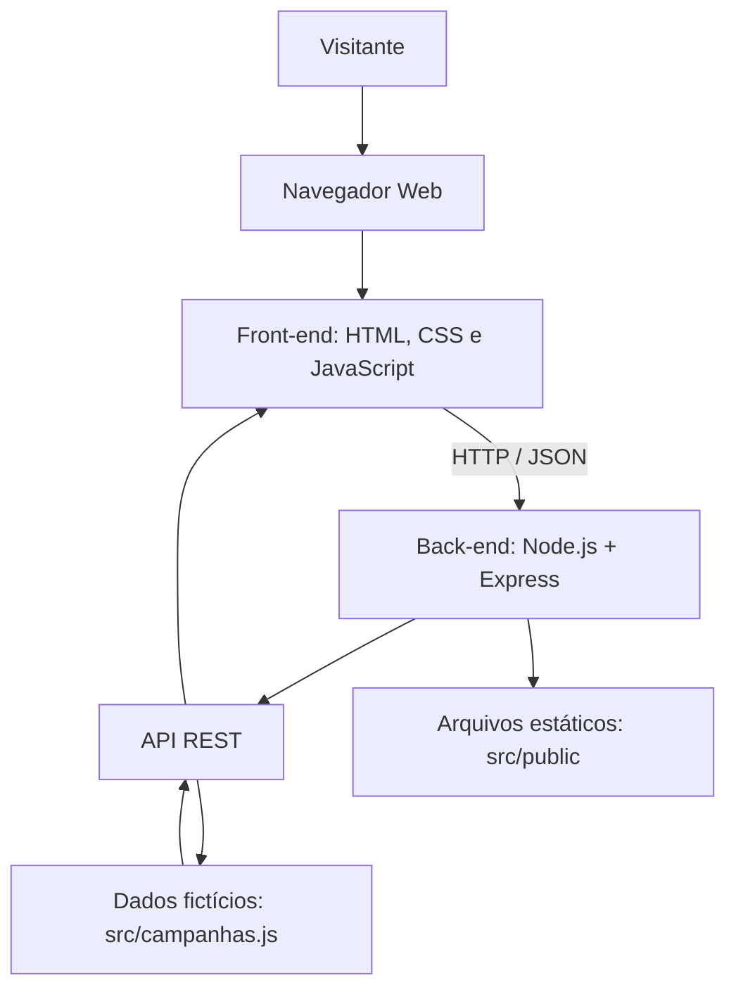

# 🏥 Agenda Saúde Tacaratu — MVP


## 📌 Sobre o projeto

O **Agenda Saúde Tacaratu — MVP** é um protótipo acadêmico de aplicação web voltado à divulgação de campanhas e ações públicas de saúde em Tacaratu, Pernambuco.

A proposta é reunir informações como título, descrição, categoria, data, horário e local em uma interface simples e acessível.

O projeto integra as atividades do curso **Desenvolvimento Web Full Stack para MVPs**, associado ao **Projeto Agenda Saúde Digital Tacaratu**.

> **Aviso:** este é um protótipo acadêmico independente. Não representa uma plataforma oficial da prefeitura ou do SUS. Os dados utilizados serão fictícios e demonstrativos.


## 🏗️ Arquitetura do sistema



📘 [Consultar documentação completa da arquitetura](docs/arquitetura.md)


## 🎯 Objetivos

- Facilitar a consulta demonstrativa de campanhas de saúde.
- Organizar os requisitos e a documentação técnica.
- Aplicar desenvolvimento web Full Stack.
- Praticar Git Flow, GitHub Issues e Pull Requests.
- Demonstrar rastreabilidade entre planejamento e implementação.

## ✅ Funcionalidades e status

| Funcionalidade | Situação |
|---|---|
| Planejamento e especificações | ✅ Documentados |
| Servidor Node.js e Express | ✅ Implementado |
| API REST de campanhas | ✅ Implementada |
| Listagem de campanhas | ✅ Implementada |
| Consulta de detalhes | ✅ Implementada |
| Filtro por categoria | ✅ Implementado |
| Tratamento de erros | ✅ Implementado |
| Interface responsiva | ✅ Implementada |
| Testes automatizados da API | ✅ 5 aprovados |
| Agendamento real de consultas | Fora do escopo |

Esta tabela será atualizada conforme as funcionalidades forem implementadas e verificadas.

## 🧰 Tecnologias

- HTML5
- CSS3
- JavaScript
- Node.js
- Express
- Git e GitHub
- Visual Studio Code

Node.js e Express são utilizados no servidor e na API REST do MVP. A aplicação está implementada, com rotas HTTP, interface web e testes automatizados.

## 📁 Estrutura do projeto

```text
agenda-saude-tacaratu-mvp/
├── docs/
│   ├── project-charter.md
│   ├── requisitos.md
│   ├── casos-de-uso.md
│   └── user-stories.md
├── src/
├── .gitignore
└── README.md
```

## 📖 Documentação técnica

- [Project Charter](docs/project-charter.md)
- [Requisitos Funcionais e Não Funcionais](docs/requisitos.md)
- [Casos de Uso](docs/casos-de-uso.md)
- [Histórias de Usuário](docs/user-stories.md)
- [Matriz de Rastreabilidade](docs/matriz-rastreabilidade.md)

## ⚙️ Instalação e execução local

### Instalar as dependências

```bash
npm install
```

No PowerShell, caso o npm seja bloqueado pela política de execução, utilize `npm.cmd install`.

### Iniciar o servidor

```bash
npm start
```

No PowerShell, utilize `npm.cmd start`, se necessário.

Acesse no navegador:

http://localhost:3000

### Endpoints da API

| Método | Endpoint | Descrição |
|---|---|---|
| GET | `/api/health` | Verificar o servidor |
| GET | `/api/campanhas` | Listar campanhas |
| GET | `/api/campanhas/1` | Consultar campanha por ID |
| GET | `/api/campanhas/999` | Exemplo de resposta HTTP 404 |

### Executar testes automatizados

```bash
npm test
```

No PowerShell, utilize `npm.cmd test`, se necessário.

**Validação inicial:** 5 testes aprovados e 0 falhas.

As campanhas apresentadas são fictícias e demonstrativas.

### Pré-requisitos

- Git instalado.
- Node.js e npm instalados.
- Editor de código, preferencialmente VS Code.

### 1. Clonar o repositório

```bash
git clone https://github.com/kauebrpe/agenda-saude-tacaratu-mvp.git
```

### 2. Entrar na pasta

```bash
cd agenda-saude-tacaratu-mvp
```

### 3. Acessar a branch de desenvolvimento

```bash
git switch develop
```


### 4. Instalar e executar

Instale as dependências:

```bash
npm install
```

Inicie a aplicação:

```bash
npm start
```

Acesse http://localhost:3000 no navegador.

Para executar os testes automatizados:

```bash
npm test
```

No PowerShell do Windows, utilize `npm.cmd` no lugar de `npm` caso a política de execução bloqueie o comando.


## 🌿 Estratégia Git Flow

| Branch | Finalidade |
|---|---|
| `main` | Versões estáveis de produção |
| `develop` | Integração do desenvolvimento |
| `feature/issue-XX-descricao` | Desenvolvimento de funcionalidades |
| `docs/issue-XX-descricao` | Criação e atualização da documentação |
| `fix/issue-XX-descricao` | Correção de defeitos |
| `release/x.y.z` | Preparação de versões estáveis |

**Fluxo adotado:**

```text
Issue → Branch temática → Commits → Push
                                 ↓
                         Pull Request
                                 ↓
                              develop
                                 ↓
                         Versão estável
                                 ↓
                               main
```

Os commits seguem o padrão **Conventional Commits**, e as versões estáveis serão identificadas com tags anotadas seguindo **Semantic Versioning**.

## 📋 Gestão de tarefas

As atividades são organizadas no [GitHub Issues](https://github.com/kauebrpe/agenda-saude-tacaratu-mvp/issues).

Cada tarefa deve possuir descrição, critérios de aceite e label, com referência ao respectivo Pull Request.

## 🔐 Privacidade e segurança

O MVP não exige cadastro de usuários, não coleta dados pessoais de saúde e não realiza agendamentos reais.

## 📄 Licença

Licença ainda não definida. Nenhuma permissão geral de reutilização é concedida por este README.

## 👨‍💻 Desenvolvimento

Projeto acadêmico individual desenvolvido por [kauebrpe](https://github.com/kauebrpe).

**Contexto:** Compet Superior — Projeto Agenda Saúde Digital Tacaratu.

**Última atualização documental:** 05/11/2026.
