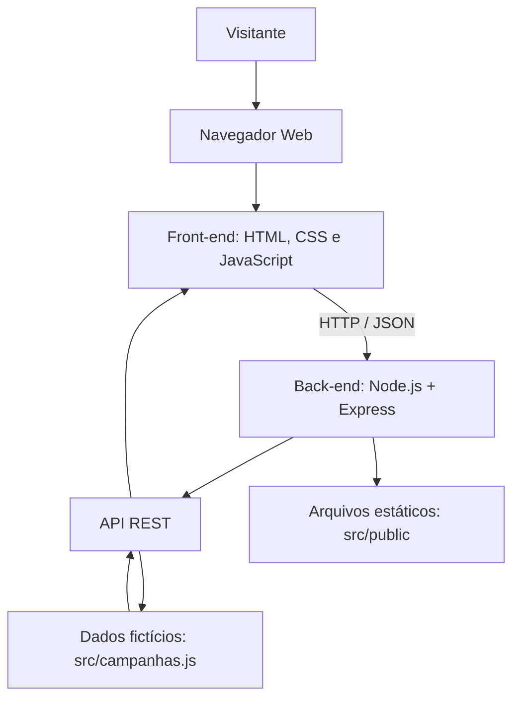

# Arquitetura do Sistema — Agenda Saúde Tacaratu MVP

## Visão geral

O Agenda Saúde Tacaratu é uma aplicação web acadêmica
para consulta de campanhas demonstrativas de saúde.

A arquitetura utiliza Front-end em HTML, CSS e JavaScript,
servidor Node.js com Express e uma API REST que consulta
dados fictícios armazenados no código-fonte.

## Diagrama de arquitetura

## Componentes

- **Front-end:** apresenta campanhas, filtros e detalhes.
- **Back-end:** disponibiliza a aplicação por meio do Express.
- **API REST:** permite consultar campanhas e identificadores.
- **Dados:** campanhas fictícias definidas em `src/campanhas.js`.
- **Testes:** cinco testes automatizados com Node.js.

## Rotas principais

| Método | Rota | Função |
|---|---|---|
| GET | `/api/health` | Verificação do servidor |
| GET | `/api/campanhas` | Listagem de campanhas |
| GET | `/api/campanhas/:id` | Consulta por identificador |

## Limitações

O projeto não utiliza banco de dados, dados reais de pacientes
nem integração com sistemas oficiais de saúde.
